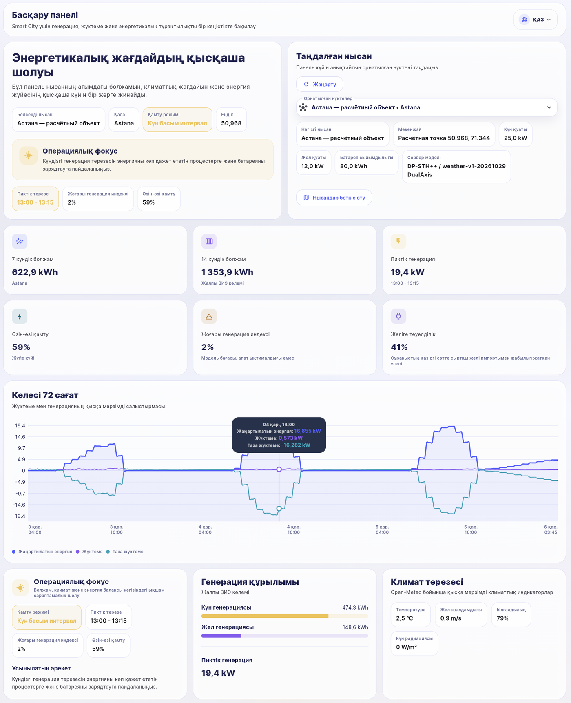
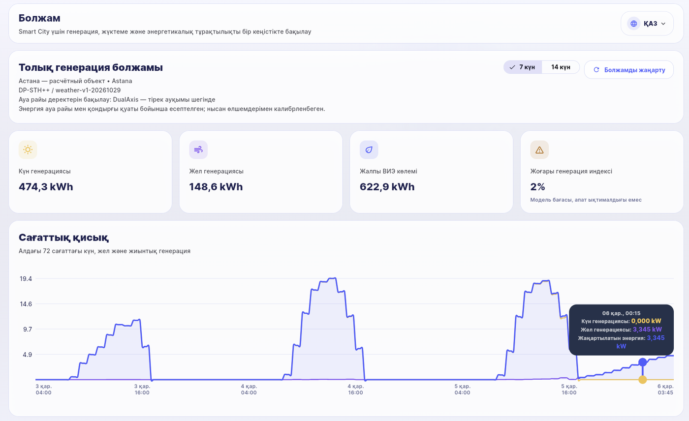
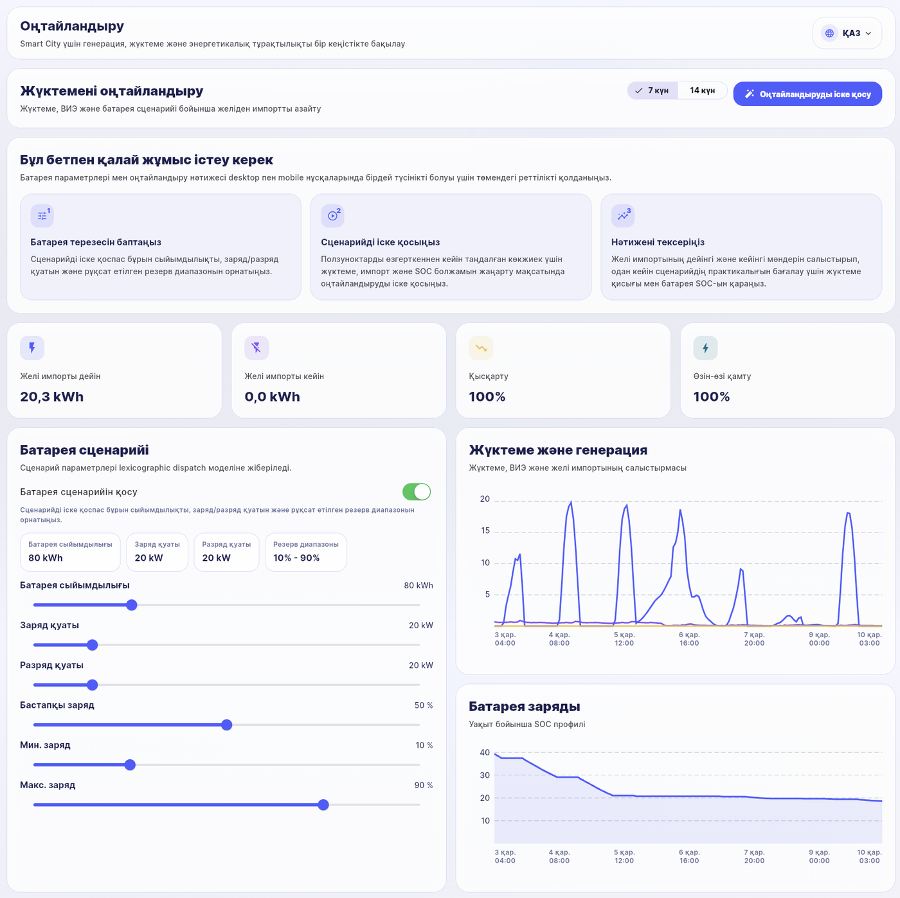
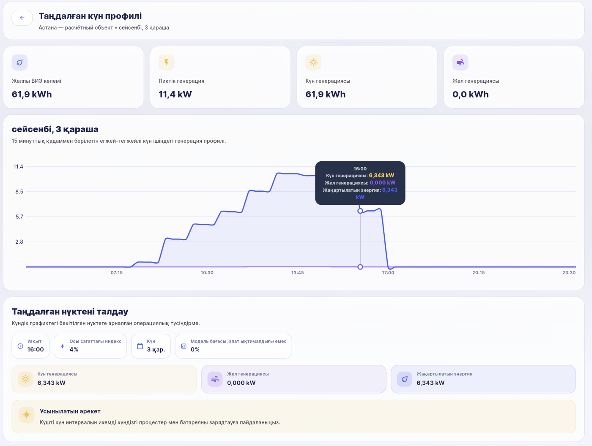
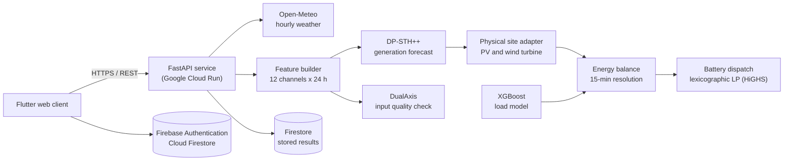
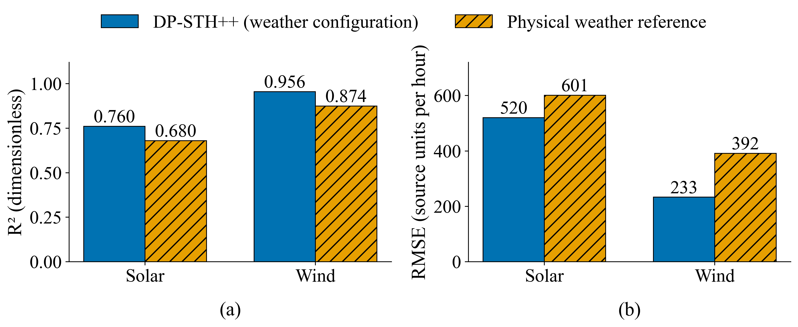

<div align="center">

# ⚡ SmartCity-RE-AI

**Cloud information system for solar and wind generation forecasting, input data quality control, energy balance and battery dispatch optimisation for smart-city energy sites**


</div>

---

## 📌 Overview

SmartCity-RE-AI turns hourly weather forecasts into site-level renewable generation forecasts and operational decisions for distributed solar and wind installations. For a registered site (coordinates, PV capacity, tilt, azimuth, wind capacity, hub height, battery parameters) the system:

| Step | What happens | Component |
|:---:|---|---|
| 1 | Hourly weather for the site is retrieved and converted into 12 model channels over 24-hour windows | Open-Meteo, feature builder |
| 2 | Hourly solar and wind generation is forecast for **7 or 14 days** (168 or 336 hours) | **DP-STH++** hybrid spatio-temporal network |
| 3 | Every forecast input window is checked by masked reconstruction | **DualAxis** quality-control network |
| 4 | Network outputs are converted into site energy by a physical PV and wind-turbine adapter | Site adapter |
| 5 | Electricity demand is forecast at 15-minute resolution and the energy balance is computed | XGBoost load model |
| 6 | Battery charge and discharge are scheduled by lexicographic linear programming | HiGHS LP solver |
| 7 | Results are shown in a multilingual web client (Kazakh, Russian, English) | Flutter web |

The two neural models address different tasks: DP-STH++ estimates generation, DualAxis assesses the quality of the data it receives. The user therefore does not choose between them; both run in every forecast request.

---

## 🖥️ Interface

| Dashboard | 14-day forecast |
|:---:|:---:|
|  |  |
| **Battery optimisation** | **Daily profile** |
|  |  |

---

## 🏗️ System architecture



### 🧠 Models

| Model | Task | Input | Output | Parameters |
|---|---|---|---|---:|
| **DP-STH++**, weather configuration | 7/14-day solar and wind forecast | 24 h × 12 weather channels | Hourly generation and extreme-regime scores | 831,728 |
| **DualAxis**, weather configuration | Quality control of forecast inputs | 24 h × 12 weather channels, 30 % masking | Normalised reconstruction error, reference threshold 0.588, status | 451,105 |
| **DP-STH++**, base configuration | Next-hour forecast from measured history | 24 h × 12 features (6 weather, 4 calendar, 2 generation) | Next-hour generation and extreme-regime scores | 831,730 |
| **DualAxis (SSL-QC)**, base configuration | QC-score of measured history | 24 h × 13 features | Integrated QC-score | 451,201 |
| XGBoost load model | Electricity demand | 23 calendar and lag features | Load at 15-min resolution | — |
| Linear program (HiGHS) | Battery dispatch | Hourly energy balance and battery limits | Charge, discharge, state of charge, grid import | — |

**DP-STH++** combines four parallel causal branches (two-layer LSTM and GRU with 128 and 64 units, three dilated causal convolutions with dilations 1, 2 and 4, two causal Transformer blocks of width 160 with four heads). Branch outputs are projected to 96 dimensions and weighted by a learned softmax gate conditioned on the last time step, followed by LayerNorm, dense layers of 224 and 128 units, two regression heads and two extreme-regime heads.

**DualAxis** applies self-attention first along the time axis and then along the feature axis (two layers each, width 96, four heads) and reconstructs masked cells of the window. Its reconstruction error is reported next to every forecast; it does not modify the forecast and is not a fault probability.

---

## 📊 Retrospective evaluation

All partitions are chronological. Scalers, reference coefficients and extreme-regime thresholds are fitted on the training block only.

| Configuration | Training | Model selection | Calibration | Hold-out |
|---|---:|---:|---:|---:|
| Weather configurations (23-h purges between blocks) | 5,228 windows | 1,290 windows | 414 windows | 1,728 windows |
| DP-STH++ base configuration | 5,585 samples | 1,397 samples | — | 1,746 samples |
| DualAxis base configuration | 6,254 windows | 678 windows | — | 1,728 windows |

<div align="center">


*Hourly hold-out accuracy of the weather configuration of DP-STH++ against the physical weather reference on 1,728 held-out hours with recorded weather: (a) coefficient of determination, (b) root-mean-square error in source units.*
</div>

| Target | Model | MAE | RMSE | R² | AUC (extreme regime) |
|---|---|---:|---:|---:|---:|
| Solar | DP-STH++, weather configuration | 259.5 | 519.9 | **0.7605** | — |
| Solar | Physical weather reference | 283.9 | 600.9 | 0.6801 | — |
| Wind | DP-STH++, weather configuration | 160.0 | 233.1 | **0.9555** | — |
| Wind | Physical weather reference | 275.3 | 391.7 | 0.8744 | — |
| Solar | DP-STH++, base configuration | 192.7 | 344.2 | 0.8948 | 0.9944 |
| Wind | DP-STH++, base configuration | 192.4 | 282.1 | 0.9358 | 0.9901 |

**Data quality control.**
- DualAxis base configuration: masked-reconstruction RMSE of 0.0943 (normalised scale, 30 % masking).
- DualAxis weather configuration:
  - none of 72 unmodified hold-out windows exceeded the reference threshold;
  - 40.28 % of windows with an artificial temperature spike exceeded it.

---

## ⏱️ Performance

| Environment | Operation | Mean time |
|---|---|---:|
| Apple M1 Pro, 16 GB, macOS (local, 3 repeats) | Loading all models at start-up | 13.2 s |
| | 7-day forecast, including the weather request | 0.58 s |
| | 14-day forecast, including the weather request | 0.61 s |
| | Next-hour forecast from measured history | 0.18 s |
| | QC-score of a 24-hour window | 0.03 s |
| Google Cloud Run, 2 vCPU, 3 GiB (10 warm requests, network included) | 7-day forecast | 1.02 s (p95 1.38 s) |
| | 14-day forecast | 1.42 s (p95 1.75 s) |
| | QC-score | 0.43 s |
| | Battery optimisation | 1.25 s |

| Resource | Value |
|---|---|
| Peak memory of the server process (all models loaded, 7- and 14-day forecasts) | 0.94 GiB |
| Training on CPU (Apple M1 Pro) | DP-STH++ weather configuration: 356 s, 27 epochs; DualAxis weather configuration: 162 s, 16 epochs |
| GPU | Not required for inference or for training the weather configurations |
| Model artefacts | about 26 MB |

---

## 🔌 REST API

| Method | Route | Purpose |
|:---:|---|---|
| `GET` | `/forecast/7d`, `/forecast/14d`, `/forecast` | Site generation forecast with DualAxis quality block and provenance |
| `GET` | `/energy/balance` | Generation, load and net load at 15-min resolution |
| `POST` | `/optimize` | Battery dispatch by lexicographic linear programming |
| `POST` | `/generation/predict` | Next-hour forecast from 24 measured hours (base DP-STH++) |
| `POST` | `/qc/score` | QC-score of 24 measured hours (base DualAxis) |
| `POST` | `/generation/analyze` | Quality check followed by forecast on the same history |
| `GET` | `/load/forecast/7d`, `/load/forecast/14d` | Electricity demand forecast |
| `GET` | `/meteo`, `/meteo/48h` | Hourly weather for the site |
| `GET` | `/health`, `/meta`, `/generation/meta`, `/qc/meta`, `/load/meta` | Service state, model versions and input contracts |

Invalid requests are rejected with HTTP 422, an unavailable model with 503 and an unavailable weather provider with 502.

---

## 📁 Repository structure

```text
SmartCity-RE-AI/
├── lib/                              Flutter web client (Riverpod, go_router, fl_chart, flutter_map)
├── test/                             Client tests and API response fixtures
├── web/  assets/  tool/              Web shell, fonts, build and deployment scripts
├── smart-city-renewable-energy-server/
│   ├── app/                          FastAPI service, model runtimes, site adapter, optimisation
│   ├── models/                       Trained artefacts: DP-STH++, DualAxis, load model
│   ├── tests/                        Server test suite with golden inference fixtures
│   └── Dockerfile  requirements.txt  deploy_cloud_run.sh
├── experiments/weather_models/       Training pipeline of the weather configurations
├── data/                             Source dataset (CC BY 4.0)
└── docs/figures/                     Interface screenshots and evaluation figure
```

---

## 🚀 Getting started

### Server

```bash
cd smart-city-renewable-energy-server
python3.11 -m venv .venv && source .venv/bin/activate
pip install -r requirements.txt
FIRESTORE_ENABLED=false python -m unittest discover -s tests
FIRESTORE_ENABLED=false uvicorn app.main:app --host 127.0.0.1 --port 8099
```

### Client

1. Create a Firebase project with phone authentication and Cloud Firestore.
2. Replace the placeholders in `lib/firebase_options.dart` and `.firebaserc`, for example with `flutterfire configure`.
3. Run:

```bash
flutter pub get
flutter gen-l10n
flutter test
flutter run -d chrome --dart-define=API_BASE_URL=http://127.0.0.1:8099
```

### Deployment

```bash
PROJECT_ID=<gcp-project-id> ./smart-city-renewable-energy-server/deploy_cloud_run.sh
PROJECT_ID=<firebase-project-id> API_BASE_URL=<https://your-api-endpoint> ./tool/deploy_firebase_hosting.sh
```

### Training the weather configurations

`experiments/weather_models/training.py` runs the stages `prepare()`, `train_dp()`, `train_qc()`, `evaluate()` and `export()` on `data/renewables_combined_FULL.csv`:
- the SHA-256 of the dataset is verified before training;
- weights, preprocessing parameters, metrics and a hashed manifest are written for the server.

---

## 🔒 Reproducibility and integrity

- **Artefact integrity.** Every DP-STH++ and DualAxis artefact is verified against SHA-256 values pinned in the server code before deserialisation. Training and serving share the same, hashed feature and architecture code.
- **Chronological validation.** Splits are chronological with purge gaps; scalers and thresholds come from training data only.
- **Determinism.** Inference outputs are compared with golden fixtures at a fixed tolerance.
- **No secrets in the repository.** The Firebase configuration, the Firebase project and the API endpoint are supplied by the user at build or deployment time.

---

## 🗃️ Data

`data/renewables_combined_FULL.csv` is the merged hourly table of the *Wind and Solar Power Generation Dataset*:
- source: Liu Y., Mendeley Data, DOI [10.17632/gxc6j5btrx.1](https://doi.org/10.17632/gxc6j5btrx.1), licensed CC BY 4.0;
- size: 8,753 rows and 18 fields (8,752 unique hourly timestamps);
- units: the source does not specify physical units, so errors are reported in source units.

---

## ⚠️ Limitations

- **Evaluation conditions.** The forecast is evaluated retrospectively with recorded weather. Lead-time accuracy under real weather forecasts requires an archive of forecasts and measured generation.
- **Site energy.** It is computed by a physical adapter from installed capacity and geometry, without calibration against measurements of a specific site.
- **Score interpretation.** The DualAxis score and the extreme-regime scores are diagnostic indicators, not calibrated probabilities of faults or events.
- **Resolution.** Values at 15- and 30-minute resolution distribute hourly energy evenly.

---

## 📚 Related research

| Repository | Topic |
|---|---|
| [solar-wind-energy-forecasting-dp-sth](https://github.com/gulnaztolegenova/solar-wind-energy-forecasting-dp-sth) | Hybrid spatio-temporal multi-task forecasting of solar and wind generation (DP-STH) |
| [Solar_Wind_SSL_Research_Project](https://github.com/gulnaztolegenova/Solar_Wind_SSL_Research_Project) | Self-supervised masked reconstruction and data quality control (DualAxis) |

**Publications**

1. Tolegenova G., Zakirova A., Kalimoldayev M., Akhayeva Zh. *Hybrid Spatio-Temporal Deep Learning Models for Multi-Task Forecasting in Renewable Energy Systems.* Computers, 15(3), 183. DOI: [10.3390/computers15030183](https://doi.org/10.3390/computers15030183)
2. Kalimoldayev M., Tolegenova G., Zakirova A., Akhayeva Zh. *Non-Forecasting Self-Supervised Masked-Reconstruction Framework.* Computers, 15(11), 761. DOI: [10.3390/computers15110761](https://doi.org/10.3390/computers15110761)

---

## 👤 Author

**Gulnaz Tolegenova** · [github.com/gulnaztolegenova](https://github.com/gulnaztolegenova)

## 📄 License

Copyright © Gulnaz Tolegenova. All rights reserved.

Third-party components keep their own licences:
- the dataset is distributed under CC BY 4.0;
- the Inter font in `assets/fonts` is distributed under the SIL Open Font License 1.1.
